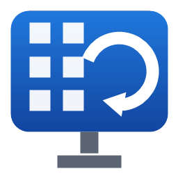
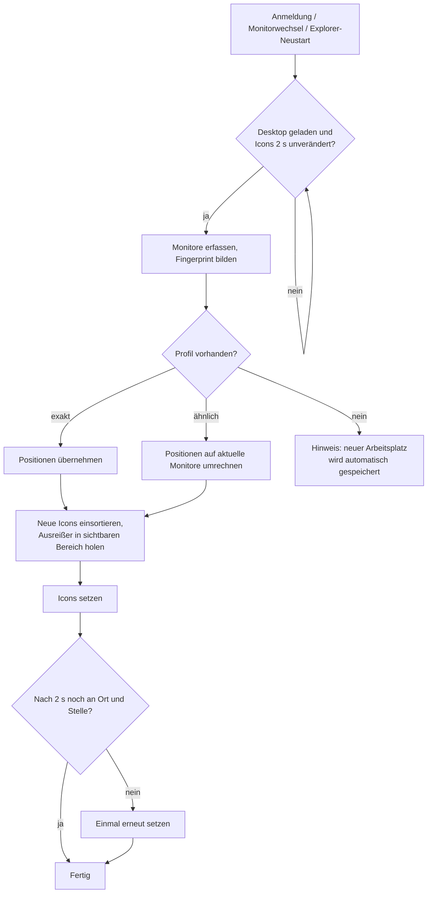

<p align="center">
  
</p>

<h1 align="center">DesktopRestore</h1>

<p align="center">
  Die Anordnung deiner Desktop-Icons pro Arbeitsplatz speichern und automatisch wiederherstellen – für Windows 11.
</p>

<p align="center">
  <a href="https://github.com/DonGismo/DesktopRestore/actions/workflows/build.yml"></a>
  
  
  
</p>

---

## Inhalt

- [Das Problem](#das-problem)
- [Funktionen](#funktionen)
- [Systemvoraussetzungen](#systemvoraussetzungen)
- [Installation](#installation)
- [Bedienung](#bedienung)
- [Einstellungen](#einstellungen)
- [So funktioniert es](#so-funktioniert-es)
- [Datenablage](#datenablage)
- [Kommandozeile](#kommandozeile)
- [Fehlerbehebung und FAQ](#fehlerbehebung-und-faq)
- [Bekannte Einschränkungen](#bekannte-einschränkungen)
- [Entwicklung](#entwicklung)
- [Releases und CI](#releases-und-ci)
- [Datenschutz](#datenschutz)

---

## Das Problem

Wer mit einem Notebook zwischen mehreren Arbeitsplätzen wechselt – Büro mit Dockingstation und zwei Monitoren,
Homeoffice mit einem 4K-Bildschirm, unterwegs nur das Notebook-Display – kennt das: Windows sortiert die
Desktop-Icons beim Anmelden oder beim An- und Abdocken neu, und die mühsam aufgebaute Ordnung ist weg.

**DesktopRestore** merkt sich die Anordnung **für jede Monitor-Konfiguration getrennt**, erkennt automatisch, an
welchem Arbeitsplatz du gerade bist, und stellt die passende Anordnung wieder her. Die App läuft unauffällig im
Infobereich der Taskleiste.

## Funktionen

| Funktion | Beschreibung |
|---|---|
| **Arbeitsplatz-Erkennung** | Erkennt den Arbeitsplatz anhand der angeschlossenen Monitore (Modell, Auflösung, Anordnung, Skalierung). |
| **Wiederherstellen beim Start** | Wartet nach der Anmeldung, bis der Desktop vollständig geladen ist, und stellt dann die passende Anordnung her. |
| **Live-Monitorwechsel** | Reagiert auf An-/Abdocken, Auflösungs- und Skalierungsänderungen, Entsperren, Standby-Ende und Explorer-Neustarts. |
| **Automatisches Speichern** | Speichert Änderungen periodisch (Standard: alle 5 Minuten) – aber nie direkt nach einem Monitorwechsel. |
| **Historie** | Pro Arbeitsplatz bleiben die letzten 10 Stände erhalten und lassen sich mit einem Klick zurückholen. |
| **Ähnliche Arbeitsplätze** | Gibt es keinen exakten Treffer (z. B. baugleicher Monitor an anderem Schreibtisch), wird das ähnlichste Layout verwendet. |
| **Neue Icons einsortieren** | Icons, die im gespeicherten Layout noch fehlen, landen sauber im Raster in der rechten (oder linken) Spalte. |
| **Sichtbarkeit garantiert** | Icons, die bei kleinerer Auflösung außerhalb des Bildschirms lägen, werden in den sichtbaren Bereich geholt. |
| **Export / Import** | Alle Layouts inklusive Historie als ZIP sichern oder auf einen neuen PC übertragen. |
| **Profilverwaltung** | Arbeitsplätze benennen („Büro“, „Homeoffice“), löschen, auf den Desktop anwenden. |
| **Kommandozeile** | `--save`, `--restore`, `--dump` für Skripte und Diagnose. |
| **Keine Cloud** | Alles bleibt lokal im Benutzerprofil. Die App baut keine Netzwerkverbindungen auf. |

## Systemvoraussetzungen

- Windows 11 (Windows 10 ab 1809 sollte ebenfalls funktionieren, wird aber nicht aktiv getestet)
- x64
- **Keine** Administratorrechte nötig
- **Keine** separate .NET-Installation nötig – die Runtime ist in der EXE enthalten

## Installation

### MSI installieren

1. `DesktopRestore-<version>.msi` aus den [Releases](https://github.com/DonGismo/DesktopRestore/releases) herunterladen
   (oder selbst bauen, siehe [Entwicklung](#entwicklung)).
2. Doppelklick auf die MSI-Datei. Es wird **nur für den aktuellen Benutzer** installiert, ohne UAC-Abfrage.
3. DesktopRestore startet direkt nach der Installation und erscheint im Infobereich der Taskleiste
   (ggf. unter dem Pfeil „Ausgeblendete Symbole anzeigen“ – das Symbol lässt sich dauerhaft in die Taskleiste ziehen).

Die Installation legt an:

| Was | Wo |
|---|---|
| Programm | `%LocalAppData%\Programs\DesktopRestore\DesktopRestore.exe` |
| Autostart | `HKCU\Software\Microsoft\Windows\CurrentVersion\Run` → `DesktopRestore` |
| Startmenü | Eintrag „DesktopRestore“ |
| Daten (zur Laufzeit) | `%LocalAppData%\DesktopRestore\` |

### Unbeaufsichtigte Installation

```powershell
msiexec /i DesktopRestore-1.0.0.msi /qn
```

### Update

Einfach die neuere MSI installieren. Eine laufende Instanz wird automatisch beendet, die gespeicherten
Layouts bleiben erhalten.

### Deinstallation

Über *Einstellungen → Apps → Installierte Apps → DesktopRestore → Deinstallieren* oder:

```powershell
msiexec /x DesktopRestore-1.0.0.msi /qn
```

Die gespeicherten Layouts unter `%LocalAppData%\DesktopRestore\` bleiben bewusst erhalten, damit sie bei einer
Neuinstallation wieder da sind. Wer alles entfernen möchte, löscht diesen Ordner von Hand.

## Bedienung

### Erste Schritte

1. **An jedem Arbeitsplatz einmal die Icons anordnen.** Beim ersten Besuch meldet DesktopRestore
   „Neuer Arbeitsplatz erkannt“. Die Anordnung wird nach einigen Minuten automatisch gespeichert –
   oder sofort über **„Anordnung jetzt speichern“**.
2. **Arbeitsplatz benennen** (optional): Rechtsklick auf das Tray-Symbol → **„Arbeitsplatz umbenennen…“**.
3. **Fertig.** Ab jetzt wird die Anordnung beim Anmelden und beim Wechsel zwischen Arbeitsplätzen
   automatisch wiederhergestellt.

### Tray-Menü

Rechtsklick auf das Symbol im Infobereich:

| Eintrag | Funktion |
|---|---|
| *Arbeitsplatz: …* | Zeigt den erkannten Arbeitsplatz. „(ähnlich)“ = kein exakter Treffer, es wird das ähnlichste Layout verwendet. |
| **Anordnung jetzt speichern** | Speichert die aktuelle Anordnung sofort für diesen Arbeitsplatz. |
| **Anordnung wiederherstellen** | Stellt die gespeicherte Anordnung sofort wieder her (auch wenn die Automatik pausiert ist). |
| **Profile verwalten…** | Öffnet die Profilverwaltung (auch per Doppelklick auf das Symbol). |
| **Arbeitsplatz umbenennen…** | Gibt dem aktuellen Arbeitsplatz einen sprechenden Namen. |
| **Exportieren… / Importieren…** | Alle Layouts als ZIP sichern bzw. einspielen. |
| **Einstellungen** | Siehe [Einstellungen](#einstellungen). |
| **Automatik pausieren** | Kein automatisches Speichern und Wiederherstellen, bis die Pause aufgehoben wird. |
| **Mit Windows starten** | Schaltet den Autostart ein/aus. |
| **Protokoll öffnen / Datenordner öffnen** | Für Fehlersuche und Backups. |
| **Beenden** | Beendet die App (der Autostart bleibt aktiv). |

### Profilverwaltung

- **Oben:** alle gespeicherten Arbeitsplätze mit Monitoren, Anzahl Icons und Zeitpunkt der letzten Speicherung.
  Der aktuelle Arbeitsplatz ist **fett** markiert.
  - **Umbenennen…** (oder Doppelklick), **Löschen**, **Auf Desktop anwenden** (wendet ein Layout auch an einem
    anderen Arbeitsplatz an – die Positionen werden auf die aktuellen Monitore umgerechnet).
- **Unten:** frühere Stände des ausgewählten Arbeitsplatzes.
  - **Diesen Stand wiederherstellen** setzt die Icons auf den alten Stand und übernimmt ihn als aktuellen.
    Der bisherige Stand wandert dabei in die Historie – nichts geht verloren.

## Einstellungen

Im Tray-Menü unter **Einstellungen**:

| Einstellung | Optionen | Standard |
|---|---|---|
| Automatisch speichern | Aus, jede Minute, alle 5 / 15 / 30 Minuten | alle 5 Minuten |
| Neue Icons platzieren | Rechts von oben, links von oben, nicht verschieben | rechts von oben |
| Beim Start wiederherstellen | an/aus | an |
| Bei Monitorwechsel wiederherstellen | an/aus | an |
| Benachrichtigungen anzeigen | an/aus | an |

Weitere Werte lassen sich direkt in `%LocalAppData%\DesktopRestore\settings.json` anpassen
(App vorher beenden):

```json
{
  "AutoSaveMinutes": 5,
  "HistoryLimit": 10,
  "NewIconZone": "RightColumn",
  "RestoreOnStartup": true,
  "RestoreOnDisplayChange": true,
  "ShowNotifications": true,
  "Paused": false,
  "DisplayChangeDelaySeconds": 3,
  "StartupStableSeconds": 2,
  "AutoSaveQuietSeconds": 60
}
```

| Schlüssel | Bedeutung |
|---|---|
| `HistoryLimit` | Anzahl früherer Stände pro Arbeitsplatz |
| `NewIconZone` | `RightColumn`, `LeftColumn` oder `Keep` |
| `DisplayChangeDelaySeconds` | Wartezeit nach einem Monitorwechsel, bevor reagiert wird (mehrere Ereignisse werden zusammengefasst) |
| `StartupStableSeconds` | So lange müssen die Icons unverändert sein, bevor wiederhergestellt wird |
| `AutoSaveQuietSeconds` | Nach einem Monitorwechsel wird so lange nicht automatisch gespeichert |

## So funktioniert es

### Arbeitsplatz-Erkennung

Für jeden aktiven Monitor werden ermittelt:

- **Modell** aus der EDID (z. B. `LEN4185`, `DEL41A8`) – über die Geräteschnittstelle des Monitors
- **Auflösung** und **Position** im virtuellen Desktop
- **Skalierung** (DPI)
- ob er der **Hauptbildschirm** ist

Daraus entsteht ein **Fingerprint** (gekürzter SHA-256), der den Arbeitsplatz eindeutig beschreibt und zugleich
Dateiname des Profils ist.

Gibt es zum aktuellen Fingerprint kein Profil, sucht DesktopRestore ein **ähnliches**: gleiche Anzahl Monitore
mit gleichen Auflösungen (nach Position sortiert). Unter mehreren Kandidaten gewinnt der mit den meisten
Übereinstimmungen bei Modell, Position, Skalierung und Hauptbildschirm. Beim nächsten automatischen Speichern
entsteht daraus ein eigenes, exaktes Profil mit demselben Namen.

### Ablauf



Die zweite Prüfung ist wichtig: Explorer sortiert nach der Anmeldung oder einem Monitorwechsel manchmal mit
Verzögerung noch einmal um.

### Automatisches Speichern – ohne das gute Layout zu überschreiben

Das größte Risiko eines solchen Tools: Windows würfelt die Icons beim Andocken durcheinander, und das Tool
speichert genau diesen Zustand. Deshalb wird **nur** gespeichert, wenn

- seit dem letzten Monitorwechsel mindestens 60 Sekunden vergangen sind,
- die Monitor-Konfiguration noch dieselbe ist, zu der die aktuelle Anordnung gehört,
- sich die Anordnung tatsächlich geändert hat (Toleranz 2 Pixel).

Jeder gespeicherte Stand schiebt den vorherigen in die Historie – falls doch einmal etwas schiefgeht, ist der
alte Stand über die Profilverwaltung mit einem Klick zurück.

### Umrechnen zwischen Konfigurationen

Wird ein Layout auf eine andere Konfiguration angewendet (ähnlicher Arbeitsplatz oder „Auf Desktop anwenden“),
wird jede Position relativ zu ihrem Monitor auf den Monitor gleicher Reihenfolge umgerechnet. Fehlt dieser
Monitor, landet das Icon auf dem Hauptbildschirm. Anschließend wird sichergestellt, dass jedes Icon vollständig
im Arbeitsbereich (ohne Taskleiste) liegt. Bei exakt gleicher Konfiguration bleiben alle Positionen
pixelgenau erhalten.

### Neue Icons

Icons, die im Layout fehlen (z. B. nach einer Softwareinstallation), werden alphabetisch in die erste freie
Rasterzelle der gewählten Spalte gelegt. Der Rasterabstand kommt von Explorer, der Versatz innerhalb der Zelle
wird aus den vorhandenen Icons gelernt – neue Icons liegen dadurch exakt im selben Raster.

Icons, die nicht mehr existieren, werden ignoriert und beim nächsten Speichern aus dem Layout entfernt.

### Technischer Zugriff auf den Desktop

Die Icon-Positionen werden über die offizielle Shell-Schnittstelle gelesen und gesetzt
(`IShellWindows.FindWindowSW(SWC_DESKTOP)` → `IShellBrowser` → `IFolderView2`) – ohne Speicherzugriffe in den
Explorer-Prozess. Icons werden über ihren **Parsing-Namen** identifiziert (vollständiger Dateipfad bzw.
`::{GUID}` für Papierkorb, Dieser PC usw.). Dadurch ist die Zuordnung unabhängig von Anzeigenamen und Sprache.

> **Hinweis:** Ist im Desktop-Kontextmenü *Ansicht → Symbole automatisch anordnen* aktiv, schaltet DesktopRestore
> diese Option beim Wiederherstellen ab – sonst würde Explorer die Positionen sofort wieder überschreiben.

## Datenablage

```text
%LocalAppData%\DesktopRestore\
├── settings.json
├── logs\
│   ├── desktoprestore.log        (rotiert bei 1 MB)
│   └── desktoprestore.log.1
└── profiles\
    ├── a14c425dd4d531de.json      aktuelles Layout eines Arbeitsplatzes
    └── a14c425dd4d531de.history\
        ├── 20261019-121124-595.json
        └── …                       frühere Stände (Standard: max. 10)
```

Aufbau eines Profils:

```json
{
  "Id": "a14c425dd4d531de",
  "Name": "Homeoffice",
  "Monitors": [
    {
      "DeviceName": "\\\\.\\DISPLAY1",
      "Model": "LEN4185",
      "Bounds":   { "X": 0, "Y": 0, "Width": 3840, "Height": 2160 },
      "WorkArea": { "X": 0, "Y": 0, "Width": 3840, "Height": 2064 },
      "Dpi": 192,
      "IsPrimary": true
    }
  ],
  "Icons": {
    "C:\\Users\\max\\Desktop\\Projekt.lnk": { "X": 72, "Y": 2, "DisplayName": "Projekt" },
    "::{645FF040-5081-101B-9F08-00AA002F954E}": { "X": 3672, "Y": 1802, "DisplayName": "Papierkorb" }
  },
  "SavedAt": "2026-10-19T12:11:24.595"
}
```

Alle Koordinaten sind physische Bildschirmpixel. Gespeichert wird atomar (temporäre Datei, dann ersetzen) –
ein Absturz während des Speicherns kann kein Profil beschädigen.

## Kommandozeile

Für Skripte, geplante Aufgaben und Diagnose. Die Ergebnisse stehen im Log.

```text
DesktopRestore.exe --save              aktuelle Anordnung für diesen Arbeitsplatz speichern
DesktopRestore.exe --restore           passende Anordnung wiederherstellen
DesktopRestore.exe --dump <datei.json> erkannte Monitore und alle Icon-Positionen ausgeben
```

| Exitcode | Bedeutung |
|---|---|
| 0 | Erfolg |
| 1 | Unbekannte Argumente |
| 2 | `--restore`: kein passendes Layout gefunden |
| 3 | Fehler (Details im Log) |

Die Kommandozeile funktioniert parallel zur laufenden Tray-App.

## Fehlerbehebung und FAQ

**Das Tray-Symbol ist nicht zu sehen.**
Es liegt vermutlich im Überlauf (Pfeil links neben der Uhr). Unter *Einstellungen → Personalisierung →
Taskleiste → Andere Symbole der Taskleiste* lässt es sich dauerhaft einblenden.

**Nach dem Andocken passiert nichts.**
Protokoll öffnen (Tray-Menü) und nach „Monitorkonfiguration geändert“ suchen. Fehlt der Eintrag, hat Windows
keinen Monitorwechsel gemeldet; über „Anordnung wiederherstellen“ lässt sich manuell auslösen. Prüfen, ob
*Bei Monitorwechsel wiederherstellen* aktiv und die Automatik nicht pausiert ist.

**Es wird ein falsches Layout verwendet.**
Im Log steht pro Erkennung `(Exact)` oder `(Similar)`. Bei `Similar` wurde kein exaktes Profil gefunden –
einfach die Icons anordnen und speichern, dann gibt es ab sofort ein exaktes Profil.

**Der gleiche Arbeitsplatz wird manchmal als neu erkannt.**
Häufigste Ursache: unterschiedliche Skalierung oder Monitor-Anordnung (z. B. wenn Windows die Monitore nach dem
Andocken in anderer Reihenfolge anordnet), oder ein Monitor startet erst verzögert. Die Monitor-Details stehen im
Log. Über *Profile verwalten* lassen sich überzählige Profile löschen.

**Icons springen kurz nach dem Wiederherstellen wieder weg.**
Prüfen, ob *Symbole automatisch anordnen* wieder aktiviert wurde (z. B. durch eine Gruppenrichtlinie). Ggf.
`StartupStableSeconds` bzw. `DisplayChangeDelaySeconds` in der `settings.json` erhöhen.

**Was passiert mit OneDrive-Desktop / umgeleiteten Desktop-Ordnern?**
Funktioniert – maßgeblich ist der vollständige Pfad, den Explorer für das Icon meldet. Ändert sich der Pfad
(z. B. Ordnerumleitung neu eingerichtet), werden die Icons als neu behandelt.

**Remote Desktop (RDP)?**
Eine RDP-Sitzung hat eigene virtuelle Monitore und wird deshalb als eigener Arbeitsplatz behandelt.
Beim Zurückwechseln an die Konsole wird die passende Anordnung wiederhergestellt.

**Kann ich Layouts auf einen neuen PC mitnehmen?**
Ja: *Exportieren…* am alten, *Importieren…* am neuen PC. Weil Icons über ihren Pfad identifiziert werden,
klappt das am besten bei gleichem Benutzernamen bzw. gleichem Desktop-Pfad.

## Bekannte Einschränkungen

- Unterstützt wird der klassische Windows-Desktop (`SHELLDLL_DefView`/`SysListView32`). Alternative Shells
  oder Desktop-Tools wie Fences können die Positionen selbst verwalten und konkurrieren mit DesktopRestore.
- Zwei baugleiche Monitore mit identischer Auflösung, Anordnung und Skalierung an verschiedenen Arbeitsplätzen
  ergeben denselben Fingerprint – das ist gewollt, die Layouts sind dann ohnehin austauschbar.
- Bisher nur mit einzelnen Monitor-Konfigurationen getestet; Erfahrungsberichte mit Docking-Szenarien sind
  willkommen.

## Entwicklung

### Voraussetzungen

- Windows 10/11 x64
- [.NET SDK 9](https://dotnet.microsoft.com/download/dotnet/9.0)
- WiX Toolset v5 wird automatisch per NuGet geladen – keine Installation nötig

### Bauen

```powershell
# Tests, Veröffentlichung (self-contained, eine EXE) und MSI
.\build.ps1 -Version 1.0.0

# ohne Tests
.\build.ps1 -Version 1.0.0 -SkipTests
```

Ergebnis:

- `artifacts\publish\DesktopRestore.exe` – eigenständige EXE (~110 MB, enthält .NET Runtime)
- `artifacts\DesktopRestore-1.0.0.msi` – Installer (~37 MB)

Nur App und Tests während der Entwicklung:

```powershell
dotnet build DesktopRestore.sln
dotnet test  DesktopRestore.sln
```

### Projektstruktur

```text
DesktopRestore/
├── src/
│   ├── DesktopRestore.Core/              Logik ohne UI
│   │   ├── Shell/
│   │   │   ├── ComInterop.cs             COM-Deklarationen (IShellWindows, IFolderView2, IShellFolder …)
│   │   │   └── DesktopIconService.cs     Icons lesen und setzen
│   │   ├── Display/
│   │   │   ├── DisplayDetector.cs        Monitore, EDID-Modell, Arbeitsbereich, DPI
│   │   │   ├── DisplayConfiguration.cs   Fingerprint
│   │   │   └── ProfileMatcher.cs         exakter / ähnlicher Treffer
│   │   ├── Layout/
│   │   │   ├── LayoutProfile.cs          Datenmodell
│   │   │   ├── LayoutStore.cs            JSON-Ablage, Historie, Export/Import
│   │   │   └── LayoutPlacer.cs           Umrechnen, Einpassen, neue Icons
│   │   ├── Settings/AppSettings.cs
│   │   ├── LayoutEngine.cs               Speichern/Wiederherstellen (von App und CLI genutzt)
│   │   ├── AppPaths.cs
│   │   └── Log.cs
│   └── DesktopRestore.App/               Tray-App (WinForms)
│       ├── Program.cs                    Single-Instance, Start
│       ├── TrayAppContext.cs             Tray-Menü, Timer, Ablaufsteuerung
│       ├── DisplayChangeWindow.cs        WM_DISPLAYCHANGE, TaskbarCreated, WM_CLOSE
│       ├── ProfilesForm.cs               Profilverwaltung
│       ├── InputDialog.cs
│       ├── Autostart.cs
│       └── Cli.cs
├── tests/DesktopRestore.Core.Tests/      xUnit: Matcher, Placer, Store
├── installer/DesktopRestore.Installer/   WiX-5-Projekt (Package.wxs)
├── assets/app.ico                        erzeugt von tools/make-icon.ps1
├── tools/make-icon.ps1
├── .github/workflows/build.yml           CI und Releases
└── build.ps1
```

### Architektur in Kürze

- **Core** kennt keine UI und ist bis auf `DesktopIconService` und `DisplayDetector` vollständig ohne Windows-APIs
  testbar. Matcher, Placer und Store sind durch Unit-Tests abgedeckt.
- **App** orchestriert: Ein unsichtbares Top-Level-Fenster empfängt System-Broadcasts
  (`WM_DISPLAYCHANGE`, `WM_SETTINGCHANGE/SPI_SETWORKAREA`, `TaskbarCreated`), dazu kommen `SessionSwitch`
  und `PowerModeChanged`. Ereignisse werden über einen Debounce-Timer zusammengefasst.
- Alle Shell-Zugriffe laufen auf dem UI-Thread (STA). Die App ist *Per-Monitor-V2*-DPI-aware, damit alle
  Koordinaten physische Pixel sind.
- Der Installer beendet eine laufende Instanz über `util:CloseApplication` (WM_CLOSE an das versteckte Fenster).

### Icon neu erzeugen

```powershell
powershell -ExecutionPolicy Bypass -File tools\make-icon.ps1
```

## Releases und CI

Der Workflow [`.github/workflows/build.yml`](.github/workflows/build.yml) läuft auf `windows-latest`:

- **Push auf `main` / Pull Requests:** Tests, Veröffentlichung und MSI-Build. Die MSI steht als
  Workflow-Artefakt zum Download bereit (Testbuild mit Version `0.0.<Laufnummer>`).
- **Tag `v*`** (z. B. `v1.0.1`): baut die MSI mit dieser Version und legt automatisch ein GitHub-Release an.

Neues Release:

```powershell
git tag v1.0.1
git push origin v1.0.1
```

Die Version muss dem MSI-Schema `Major.Minor.Build` entsprechen (Major/Minor ≤ 255, Build ≤ 65535).
Änderungen werden in [CHANGELOG.md](CHANGELOG.md) dokumentiert.

## Datenschutz

DesktopRestore arbeitet ausschließlich lokal. Es werden keine Daten übertragen, es gibt keine Telemetrie,
keine Update-Prüfung und keine Cloud-Anbindung. Gespeichert werden nur Monitor-Kenndaten sowie Pfade und
Positionen der Desktop-Icons im eigenen Benutzerprofil.
